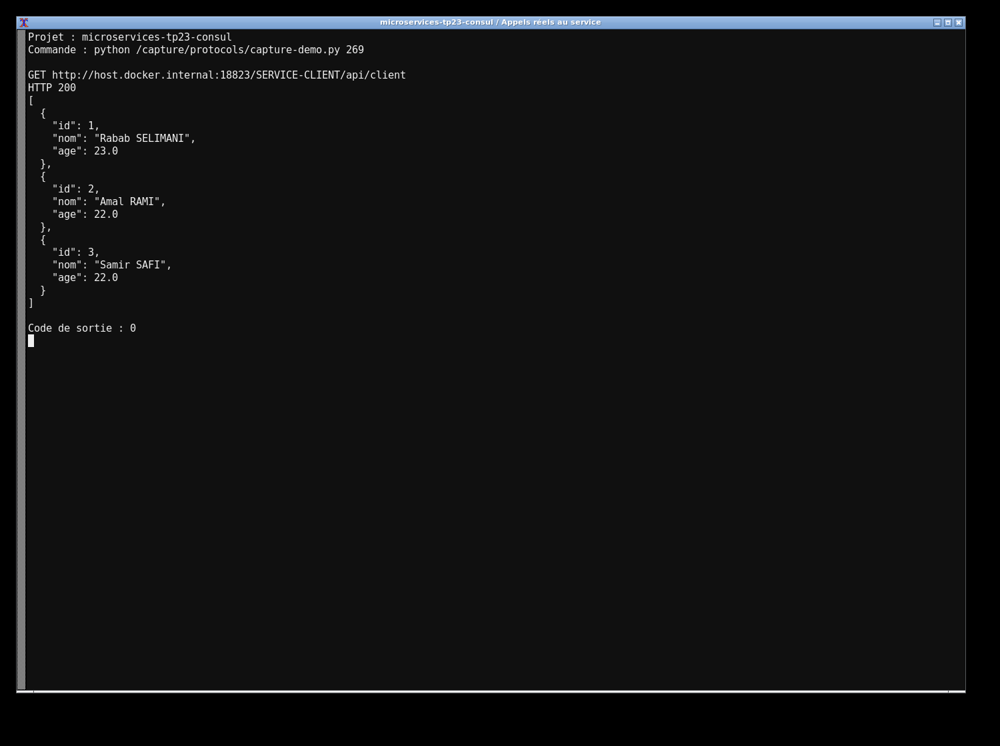
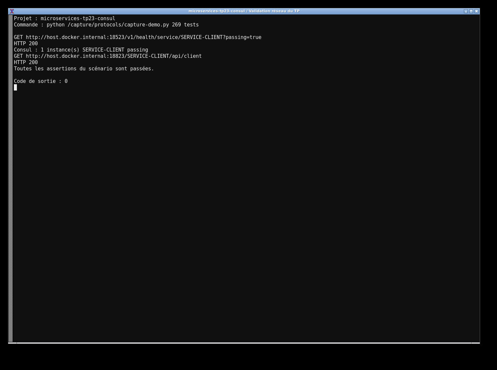

# TP23 — Migration vers Consul

Les services Client et Gateway utilisent maintenant Consul Discovery. Le projet ne contient plus de dépendance Eureka, ni de configuration de registre Netflix. Les contrôles de santé Consul appellent réellement `/actuator/health` et le routage dynamique reste basé sur le nom SERVICE-CLIENT.

```bash
mvn clean verify
docker compose up --build -d
```

Consul est accessible sur `http://localhost:18523`, Client sur 18023 et la Gateway sur 18823. L’appel `http://localhost:18823/SERVICE-CLIENT/api/client` doit renvoyer les clients. Compose démarre aussi MySQL avec une base réservée au service Client. Les identifiants présents sont seulement ceux de cet environnement local.

Les Dockerfiles utilisent les jars construits par Maven. En mode Java local, CONSUL_HOST, CONSUL_PORT et les variables DB_URL, DB_USER, DB_PASSWORD permettent d’adapter les adresses. Dans Docker, les health checks utilisent les noms des conteneurs.

Les résultats d’enregistrement, les contrôles passing et l’appel via la Gateway sont conservés dans `evidence/`. Les tests de l’API Client couvrent la création, modification, suppression et validation.



